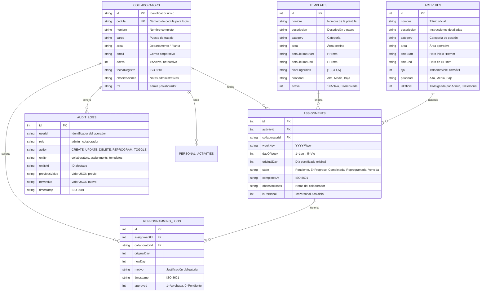

# AUDITORÍA TÉCNICA Y ARQUITECTURA DE TRANSFORMACIÓN — TRACK60
## Evolución del Sistema Operativo a Plataforma Empresarial de Gestión, Asignación y Seguimiento

**Fecha de Auditoría:** Noviembre 2026  
**Proyecto:** TRACK60 (Evolución de Standard Work)  
**Organización:** Darnel Group · Excelencia Operacional  
**Framework:** Flutter (Material 3) · Dart Nativo · SQLite Local · Arquitectura Desacoplada para Futura Integración con SharePoint  

---

## 1. DIAGNÓSTICO DEL SISTEMA ACTUAL Y FUENTES DE VERDAD

### 1.1. Estado de la Implementación
El workspace actual contiene una aplicación móvil completamente funcional y probada mediante un conjunto de 22 pruebas unitarias y de integración en `standard_work_app/test/`:
1. **Motor de Persistencia:** Base de datos SQLite local (`darnel_standard_work.db`, versión 4) gestionada a través de `DatabaseHelper` y `StandardWorkRepository`.
2. **Lógica de Negocio Original (Excel):**
   - Basada estrictamente en el libro oficial `ST - WR YONNY LOPEZ.xlsb`.
   - **270 actividades programadas** estructuradas en 4 semanas (Semana 1 a Semana 4) de lunes a viernes.
   - **7 categorías operativas oficiales:**
     1. *Operación y Ejecución* (115 actividades · 42.6% del tiempo)
     2. *Resultados y Productividad* (72 actividades · 26.7% del tiempo)
     3. *Calidad e Inocuidad* (45 actividades · 16.7% del tiempo)
     4. *Seguridad Industrial* (38 actividades · 14.0% del tiempo)
     5. *Liderazgo y Desarrollo de Personas*
     6. *Proyectos y Mejora Continua*
     7. *Administración*
   - **Actividades fijas obligatorias inamovibles:** `Reunión Diaria (Visual Room)` y `Gemba Walk` (lunes a viernes).
   - **Cálculo de Cumplimiento:** Porcentaje estricto basado únicamente en actividades evaluables transcurridas hasta el día actual de la semana, previniendo divisiones por cero.

### 1.2. Brecha entre el Estado Actual y los Requerimientos de TRACK60

| Dimensión | Sistema Anterior (Standard Work) | Nueva Plataforma TRACK60 |
| :--- | :--- | :--- |
| **Identidad Visual** | Identidad experimental "Standard Work" | Marca corporativa premium **TRACK60** inspirada en el minimalismo y sofisticación de Apple |
| **Control de Acceso** | Selección libre de perfil desde lista pública | **Acceso Dual Estricto:** Administrador (PIN `1428` + Biometría) y Colaboradores (Cédula) |
| **Asignación de Tareas** | Actividades autocontenidas por usuario | **Gestión Centralizada:** El administrador crea, parametriza y asigna individual o masivamente |
| **Tipos de Actividades** | Actividades indistintas en la base | **Clasificación Estricta:** Oficiales Obligatorias (Admin) vs. Actividades Personales (Colaborador) |
| **Plantillas** | No implementadas | **Sistema de Plantillas Reutilizables:** Crear, duplicar, activar y asignar masivamente |
| **Reprogramación** | Movimiento de día sin justificación persistente | **Trazabilidad Completa:** Motivo obligatorio, preservación de fecha original y log de auditoría |
| **Supervisión** | Visualización individual aislada | **Módulo de Supervisión 360:** Filtros multi-criterio, seguimiento de atrasos y reprogramaciones |
| **Arquitectura de Datos** | Acoplada directamente a SQLite | **Capa de Abstracción `Track60Storage`** lista para SharePoint / Power Automate |

---

## 2. ARQUITECTURA DE DATOS Y MIGRACIÓN SQLITE V5

Para evolucionar la base de datos sin destruir los registros históricos ni las 270 actividades oficiales del libro Excel, se actualiza el esquema a la **Versión 5** con las siguientes tablas:



---

## 3. ARQUITECTURA DE SEGURIDAD Y CONTROL DE ACCESO

### 3.1. Acceso Administrativo
* **Acceso:** Botón elegante «Acceso Administrativo» en la pantalla de bienvenida con distintivo de seguridad.
* **Mecanismo Dual:**
  1. **Autenticación Biométrica:** Mediante APIs del dispositivo cuando el hardware lo soporte (FaceID/TouchID/Huella en Android/iOS).
  2. **PIN Administrativo de Respaldo:** PIN inicial representativo `1428` con teclado numérico personalizado y prevención de ataques de fuerza bruta.
* **Permisos del Administrador:**
  - Control total sobre creación, edición, activación y desactivación de colaboradores.
  - Creación y parametrización de actividades obligatorias oficiales.
  - Asignación individual y masiva a múltiples colaboradores.
  - Configuración y duplicación de plantillas.
  - Supervisión en tiempo real de actividades atrasadas, completadas y reprogramadas con motivos.
  - Consulta de la bitácora inmutable de auditoría.
  - Generación de reportes ejecutivos en PDF y CSV.

### 3.2. Acceso del Colaborador
* **Acceso:** Ingreso rápido mediante **Número de Cédula**.
* **Validación:** El sistema verifica en SQLite que la cédula exista y tenga `activo == 1`. Si el usuario fue desactivado administrativamente, se deniega el acceso con mensaje explicativo, preservando su historial.
* **Permisos del Colaborador:**
  - Consulta exclusiva de sus propias asignaciones.
  - Registro de inicio y finalización de tareas (con marcas de tiempo y notas).
  - Reprogramación justificada (motivo obligatorio, preservando fecha original).
  - Creación de **Actividades Personales** (identificadas visualmente con etiqueta especial), las cuales puede editar o eliminar sin alterar las asignaciones oficiales de la administración.
  - **Restricción estricta:** Un colaborador nunca tiene acceso a herramientas de administración, perfiles de terceros ni eliminación de tareas oficiales.

---

## 4. PREPARACIÓN ESTRATÉGICA PARA SHAREPOINT

Para asegurar que la integración futura con SharePoint (una vez aprobada por TI) sea transparente y no requiera reconstruir la aplicación, se implementa el patrón **Repository & Storage Provider**:

```dart
abstract class ITrack60Storage {
  // Colaboradores
  Future<List<CollaboratorModel>> getCollaborators();
  Future<void> saveCollaborator(CollaboratorModel collaborator);
  
  // Asignaciones
  Future<List<AssignmentModel>> getAssignmentsForUser(String userId, String weekKey);
  Future<void> assignActivity(AssignmentModel assignment);
  Future<void> updateAssignmentState(int id, String newState, {String? notes});
  
  // Reprogramaciones y Auditoría
  Future<void> logReprogramming(ReprogrammingLogModel log);
  Future<void> writeAuditLog(AuditLogModel audit);
}
```

* **Fase Actual (Offline First):** `SqliteTrack60Storage` ejecuta toda la persistencia en el dispositivo mediante SQLite, asegurando funcionamiento continuo 100% offline en planta.
* **Fase Futura (M365 / SharePoint):** Bastará con implementar `SharePointTrack60Storage`, la cual mapeará cada entidad a Listas de SharePoint a través de Microsoft Graph REST API, utilizando tokens OAuth2 / Azure AD proporcionados por TI.

---

## 5. PLAN DE IMPLEMENTACIÓN POR MÓDULOS

1. **Módulo 1: Identidad y Tema TRACK60 (`AppTheme`, `AppColors`, logos y tipografía).**
2. **Módulo 2: Modelos de Datos V5 y Migración SQLite (`UserProfile` con cédula, `TemplateModel`, `ReprogrammingLog`, `NotificationModel`).**
3. **Módulo 3: Pantalla de Bienvenida y Autenticación Dual (Cédula para Colaborador + Modal PIN `1428` / Biometría para Administrador).**
4. **Módulo 4: Panel del Administrador (Dashboard Ejecutivo, Gestión de Colaboradores, Asignador Masivo, Plantillas).**
5. **Módulo 5: Supervisión y Trazabilidad (Bitácora de Reprogramaciones con Justificación, Historial Inmutable).**
6. **Módulo 6: Dashboard y Experiencia del Colaborador (Mis Actividades, Tareas Personales, Flujo de Estados, Reprogramación).**
7. **Módulo 7: Suite de Pruebas Automatizadas (25+ tests de integración y validación de reglas de negocio).**

